# Folio 技术架构与业务迭代指南

> 源码基线：2026-10-15，整理时 HEAD 为 `ac6321ca2`。本文记录当前实现，供后续业务重构、能力扩展和变更评审使用；代码继续演进时应同步维护。
>
> 标为“当前”的图和表描述已有代码；“接入约定”“迁移建议”指导后续开发；示例目录和示例能力不代表已实现业务。

## 1. 阅读入口与架构边界

当前工程是 Electron 工作台与原生能力框架，已有多窗口、语言配置、原生窗口、BrowserView 和共享纹理预览控制链。`node-bizmodules` 当前只有 `TestModule` 验证模块，产品页面尚未接入账号、房间、登录、直播等生产业务。

| 开发任务 | 重点阅读 |
| --- | --- |
| 理解全局边界与目录 | [进程图](#processes)、[目录结构](#directories)、[依赖规则](#dependencies) |
| 新增 Main / TypeScript 能力 | [通用 IPC](#electron-ipc)、[纯 TS 能力接入](#add-ts) |
| 复用已有 C++ 业务 | [业务模块宿主](#business)、[C++ 业务接入](#add-biz) |
| 新增媒体原生能力 | [媒体服务与协议](#media)、[生成链](#generation)、[媒体 Service 接入](#add-media) |
| 调整预览、窗口、生命周期 | [窗口](#windows)、[纹理与资源所有权](#preview)、[启停](#lifecycle) |
| 规划旧业务重构与验收 | [迁移路线](#migration)、[构建发布](#build)、[验收与限制](#verification) |

### 1.1 三条能力实现路径

| 路径 | 当前实例 | 职责与选择依据 | 运行位置 |
| --- | --- | --- | --- |
| Main 纯 TypeScript | `configuration`、窗口管理 | 文件、配置、Electron 窗口编排及轻量业务逻辑 | Electron Main |
| 本进程 C++ 业务模块 | `TestModule` | 复用 C++ 业务逻辑，以具名 N-API 方法暴露能力；耗时工作须另行设计线程与回调 | Main 加载的 `node-bizmodules.node` |
| 独立媒体 Service | `NativeWindowService`、`StreamPreviewService` | 原生窗口、图形资源、媒体处理及进程隔离 | `media-service.exe`，由 `node-media-service.node` 连接 |

IPC 解决进程间的能力暴露、校验与生命周期问题。实际业务对象仍需要在 Main 的装配入口明确创建和连接。这里采用静态装配：`bootstrap.ts` 管理实例与生命周期，`registerIpc.ts` 连接能力。新增业务不应向媒体容器登记配置或通用业务对象。

### 1.2 当前技术栈

| 层 | 源码中的版本或约束 | 来源 |
| --- | --- | --- |
| 桌面运行时 | Electron `44.7.0` | `frontend/package.json` |
| UI | React / React DOM `19.3.0`，多 HTML 入口 | `frontend/package.json`、`vite.config.mjs` |
| 语言与打包 | TypeScript `7.0.2`、Vite `8.3.4`；TS strict、ES2022 / NodeNext | package、tsconfig |
| 本地 Node 工具链 | `>=22.12.0`；不代表 Electron 内嵌 Node 的版本 | `engines.node` |
| 原生构建 | CMake `>=3.25`、C++11、Windows x64 为当前实现路径 | `core/CMakeLists.txt` |
| 原生协议 | FlatBuffers `25.9.23`；C++、flatc 与 JS 版本应一致 | `core/cmake/FlatBuffers.cmake` |
| 存量依赖 | `@electron/remote 2.1.3` 仍在依赖与 stage 中 | package、`scripts/build.py` |

本子工程使用自己的 `core/` CMake 与 `build/core/` 构建目录。父仓 Qt 工程的构建目录和测试体系不能直接当成本子工程入口。

<a id="processes"></a>
## 2. 进程、通信与部署视图

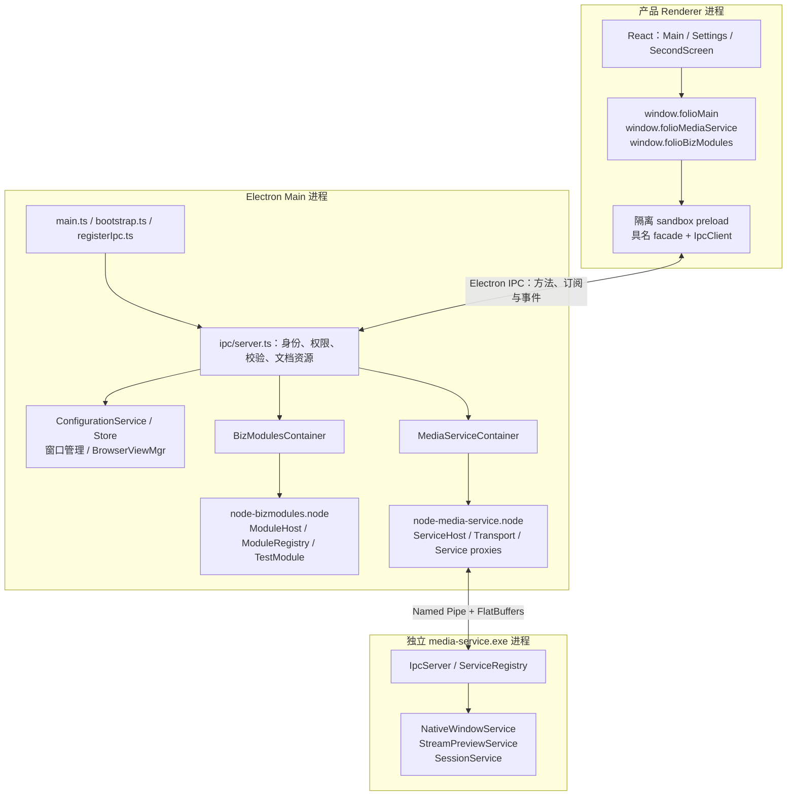

此图展示控制面与应用管理的进程边界；帧数据面另见[共享纹理时序](#preview)。Electron 还会创建 GPU、utility 等运行时进程。`node-bizmodules.node` 和 `node-media-service.node` 是 Main 内加载的两个 addon，不是两个业务子进程。

BrowserView 的实际实现是 `WebContentsView`，具有自己的网页文档，没有产品 preload，不属于获准调用上述三组 API 的产品页面。

### 2.1 两种 IPC 与一条帧通路

| 链路 | 传输内容 | 实现入口 | 业务扩展方式 |
| --- | --- | --- | --- |
| Renderer ↔ Main | 普通参数、结果、状态与领域事件 | `frontend/src/ipc/` | 模块内 `contract.ts` + `ipc.ts`，手写显式绑定 |
| Main addon ↔ 媒体进程 | 方法请求、回执、原生事件；含 session / request ID | `Transport`、`IpcServer`、`core/schemas/` | FBS + 生成代理 + 服务端实现 |
| Main → preload / Renderer | 共享纹理与帧元数据 | Electron `sharedTexture` | 保留纹理专用通路；bind、unbind、归还 token 仍走通用 IPC |

两套契约各自服务于边界。Electron IPC 不依赖 FlatBuffers 生成器；FBS 也不负责生成 Renderer 的窗口 API。

<a id="directories"></a>
## 3. 当前目录结构与职责

```text
folio/
├─ docs/
│  └─ technical-architecture.md        # 本文：架构事实与扩展指南
├─ FRAMEWORK.md                       # 架构文档入口
├─ core/
│  ├─ CMakeLists.txt                  # 本子工程原生构建入口，C++11
│  ├─ cmake/                          # FlatBuffers / Spdlog / Schemas
│  ├─ schemas/
│  │  ├─ service.fbs                  # 通用信封与 SessionService
│  │  ├─ native_window_service.fbs
│  │  ├─ stream_preview_service.fbs
│  │  └─ generate.py                  # 生成协议头、traits、addon 代理和代理工厂表
│  ├─ common/protos/                  # 已入库的生成头
│  ├─ media-service/
│  │  ├─ include/                    # Application / EventLoop / IPC / Service 接口
│  │  └─ src/
│  │     ├─ main.cpp / application.cpp
│  │     ├─ base/                     # 服务注册表、IPC、事件循环、平台实现
│  │     └─ services/
│  │        ├─ register.h / register.cpp   # 服务端统一工厂表
│  │        ├─ native_window/
│  │        ├─ stream_preview/
│  │        └─ session/
│  ├─ node-media-service/
│  │  ├─ index.d.ts
│  │  └─ src/
│  │     ├─ addon.cpp
│  │     ├─ runtime/                  # ServiceHost、Transport、N-API 工具
│  │     ├─ services/                 # 生成的同名代理、代理工厂表；ServiceProxy 基类
│  │     └─ texture-handle/           # 原生共享纹理 handle 适配
│  ├─ node-bizmodules/
│  │  ├─ index.d.ts
│  │  └─ src/
│  │     ├─ addon.cpp                 # createBizModules 与环境清理
│  │     ├─ runtime/                  # Module / ModuleHost / ModuleRegistry
│  │     ├─ bindings/                 # N-API 工具
│  │     └─ modules/test/             # 当前唯一业务 fixture
│  └─ utils/                         # 原生通用日志、字符串等
├─ frontend/
│  ├─ package.json / package-lock.json
│  ├─ tsconfig.json / tsconfig.app.json
│  ├─ vite.config.mjs                 # 多入口 React 应用
│  ├─ vite.preload.config.mjs         # sandbox preload 自包含 CJS bundle
│  ├─ scripts/dev.mjs                # Vite 与 Electron 开发启动编排
│  └─ src/
│     ├─ ipc/
│     │  ├─ contract.ts              # 浏览器安全描述符、validators、推导类型
│     │  ├─ client.ts                # preload 侧客户端
│     │  └─ server.ts                # Main 侧授权、分发与资源回收
│     ├─ main/
│     │  ├─ main.ts                  # Electron ready 与启动失败入口
│     │  ├─ bootstrap.ts             # 实例装配与全局启停
│     │  ├─ registerIpc.ts           # 四组模块的显式 IPC 装配
│     │  ├─ appPaths.ts / logger.ts
│     │  ├─ infrastructure/
│     │  │  ├─ configuration/        # contract / ipc / service / store
│     │  │  └─ sanitizeLog.ts
│     │  ├─ mediaService/            # contract / ipc / addon / 容器与媒体门面
│     │  ├─ bizModules/              # contract / ipc / addon / 模块适配与容器
│     │  └─ window/                  # contract / ipc / 各窗口与 BrowserView 管理
│     ├─ preload/preload.ts          # 三组公共 facade 与共享纹理 receiver
│     ├─ common/                     # page / localization 旧 import 的兼容转出
│     └─ app/
│        ├─ app.tsx / types.d.ts / styles.css / shared.ts
│        ├─ main.html / settings.html / secondscreen.html
│        ├─ entries/                 # 三个页面的 React 启动入口
│        ├─ pages/                   # Main / Settings / SecondScreen
│        ├─ components/              # ui / NativePreview / BrowserView / StreamPreview
│        ├─ hooks/                   # useMediaStatus / useWindowControls
│        ├─ services/windows.ts      # Renderer 窗口 facade
│        └─ locales/                 # LocaleProvider、en、zh-CN
├─ config/
│  ├─ app.ico / tray.ico             # 构建期图标输入
│  └─ bin/settings.ini              # stage 到产物根目录的运行时文件
├─ scripts/build.py                  # 正式构建与 stage 入口
└─ build/                            # Git 忽略
   ├─ core/                          # 本子工程 CMake 构建树
   ├─ bin/Debug/                     # 可分发目录；Release 使用对应配置目录
   ├─ cache/verification/            # 本地临时测试脚本，不入库、不打包
   └─ logs/                          # 构建、验证与报告证据
```

### 3.1 命名与归属约定

| 名称 | 含义 | 当前例子 / 后续约定 |
| --- | --- | --- |
| `contract.ts` | 一个所属模块的跨边界公开声明 | 文件放在实现旁；可包含同一领域的多个 capability |
| `ipc.ts` | 契约到具名业务方法、事件源的绑定 | `registerConfigurationIpc`；不实现业务规则 |
| `*Service` | 具体能力或领域服务 | `ConfigurationService`、C++ `NativeWindowService` |
| `*Store` | 状态与持久化 | `ConfigurationStore`；不感知 IPC |
| `*Container` | 同一宿主的门面与生命周期集合 | `MediaServiceContainer`、`BizModulesContainer` |
| `*Host` / `*Registry` | 原生宿主生命周期 / 静态工厂装配 | `ModuleHost` / `ModuleRegistry` |
| capability ID | Electron IPC 能力标识 | `configuration`、`testModule`，采用稳定 camelCase |
| 原生 service / module ID | C++ 类名 | `NativeWindowService`、`TestModule` |
| addon root 属性 | ID 的 camelCase | `nativeWindowService`、`testModule` |

不新增顶层 `contracts/`。`main/**/contract.ts` 虽在 Main 目录下，内容必须浏览器安全；preload 只导入这些契约，不导入同目录实现。`common/` 只保留现有兼容转出，新业务不要再次把所属契约集中到那里。

<a id="dependencies"></a>
## 4. 依赖方向与装配边界

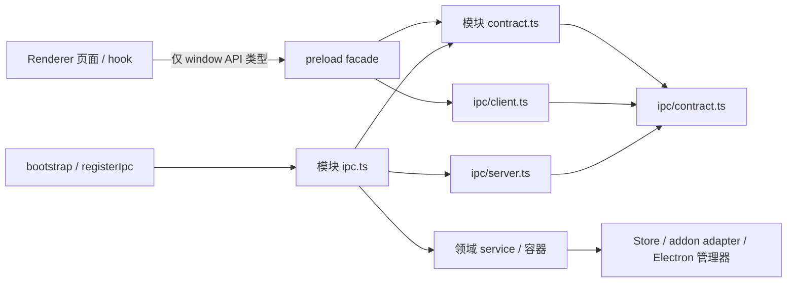

箭头表示代码依赖或公开类型关系，不表示 Renderer 可以加载 preload 的运行时实现。`app/types.d.ts` 使用 type import 从实际 facade 推导三组全局 API。

接入约定：

1. IPC 核心不导入 configuration、业务模块、媒体或窗口实现，新增能力无需增加核心分发分支。
2. 契约只包含描述符、类型与数据校验；禁止 Node、Electron Main、文件系统、addon 等运行时依赖。
3. 模块 `ipc.ts` 将可信 `Caller` 显式传给需要资源归属判断的服务；不把原始 `ipcMain` 散落到业务中。
4. 领域内部可明确注入所需依赖；不要把相邻模块的实现藏到通用注册器、字符串 service locator 或动态反射里。
5. preload 显式组合公开方法，Renderer 使用具名 API。内部 transport 不暴露为 `invoke(channel, ...)`。

当前仍有单例和显式耦合，例如 `mainWindow.ts` 使用媒体容器，`BrowserViewMgr` 接受原生窗口门面协调遮挡。它们是窗口与媒体资源编排的实际连接点；未来业务依赖注入应在对应装配入口演进，不应把本文的分层图理解为已有完整 DI 框架。

<a id="electron-ipc"></a>
## 5. 通用 Electron IPC

源码：[contract.ts](../frontend/src/ipc/contract.ts)、[server.ts](../frontend/src/ipc/server.ts)、[client.ts](../frontend/src/ipc/client.ts)。

### 5.1 当前公开能力与权限

“登记页面”指 Main 管理器认可的产品 BrowserWindow 顶层文档。权限 `main` 指 ID 为 `main` 的产品 Main 页面，不表示只有 Electron Main 代码能调用；Main 内部可以直接调用服务。

| Renderer 公开入口 | capability / 方法 | 可调用者 | 事件或订阅 |
| --- | --- | --- | --- |
| `folioMain.configuration` | `configuration.get / setLanguage` | 登记页面 | `onLanguageChanged` |
| `folioMain.windows` | `windows.control / ready / getState / showWindow / closeWindow / closeAllWindow` | 登记页面 | `onState` |
| `folioMain.browserView` | `browserView.create / load / setRect / release` | Main 页面 | `onEvent`，Main 页面 |
| `folioMain.onIpcError` | preload 本地错误观察器，无独立 capability | 获得该 preload 的页面 | IPC 订阅 / 回调失败通知 |
| `folioMediaService.media` | `media.getStatus` | 登记页面 | `subscribeStatus` |
| 同上 | `media.initialize / stop` | Main 页面 | — |
| `folioMediaService.nativeWindowService` | `create / setRect / setVisible / release / releaseAll / refresh` | Main 页面 | — |
| `folioMediaService.streamPreviewService` | `bind / unbind / releaseVideoFrame` | 登记页面，含 SecondScreen；服务另查消费者归属 | `subscribe(id, onFrame)` 为帧专用 facade |
| `folioBizModules.testModule` | `testModule.echo / publish` | 登记页面 | `subscribe('changed', callback)` |

当前权限模型只有 `'page' | 'main'`。没有角色数组、账号权限系统或细粒度 RBAC。新增敏感业务需要在领域内补充真实业务授权，页面身份不能替代账号身份。

### 5.2 统一信封与校验

```ts
// 四个通道，内部使用；不作为 Renderer 的通用 API 导出。
'ipc:invoke'       // { capability, method, args }
'ipc:subscribe'    // { capability, event, token }
'ipc:unsubscribe'  // { capability, event, token }
'ipc:event'        // { capability, event, token, payload }

// Main 对调用与订阅请求的回执；失败在 IpcClient 转为 rejected Promise。
type Reply<T> = { ok: true; value: T } | { ok: false; error: string };
```

Main 按以下顺序建立边界：

1. sender 对应已登记产品窗口；请求来自当前顶层 `mainFrame`，frame 未 detached。
2. 页面 URL 与登记值匹配；比较忽略 query/hash。`showWindow` 输入的 query 另由窗口契约约束；业务直接读取 `location.search` 时仍须自行校验。
3. 捕获文档身份：frame 对象、frameToken、processId、routingId、规范化 URL。
4. capability、method / event 在冻结的契约白名单中，按 `page / main` 授权。
5. 参数通过模块 validator 后调用具名 handler；结果与事件 payload 也需通过 validator。

`isRecord` 只接受普通对象或 null prototype 数据对象，拒绝 accessor；查表读取自身 data property，拒绝 `constructor / toString / __proto__` 等条目。每个文档最多 256 条 Main 订阅，订阅 token 是数字字符串。TS 类型不替代这些运行时校验。

### 5.3 一次请求的时序

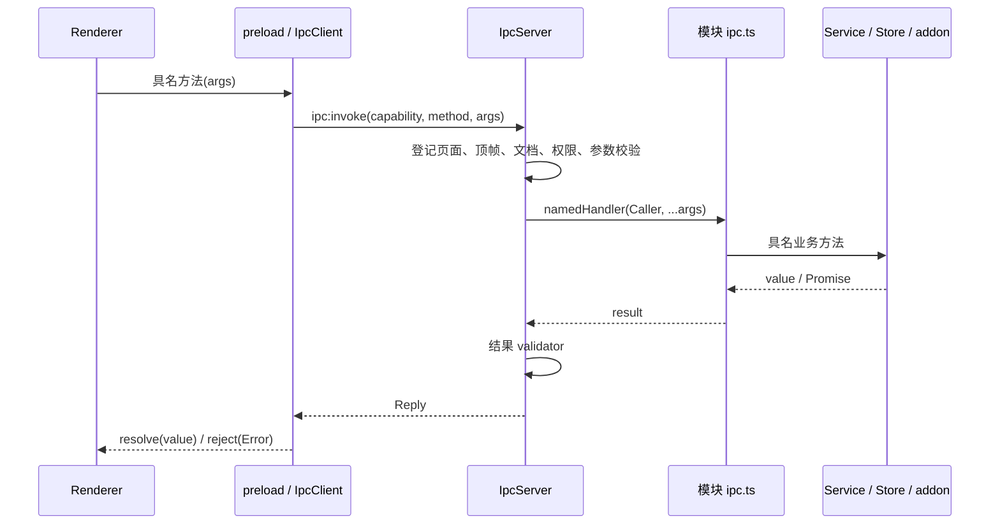

当前错误信封只有字符串 `error`；没有统一错误码、请求超时、取消协议、重试、幂等键或审计 ID。这些属于后续明确需求触发的扩展，调用方不得假设框架已提供。

### 5.4 订阅握手、复用与取消

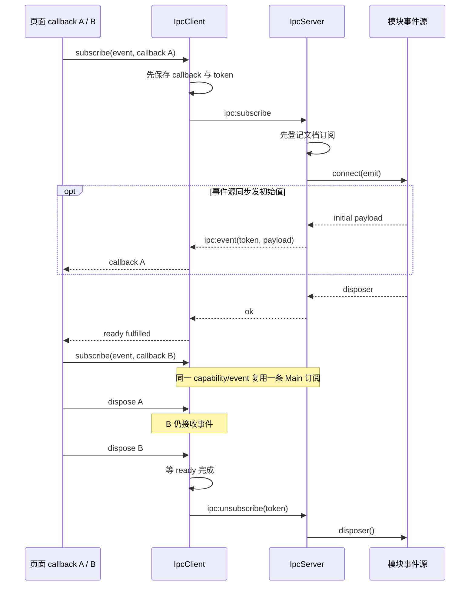

每个回调独立注册；preload 分发隔离回调异常，过期 token 的事件被丢弃。握手未完成就取消时，客户端等待握手成功后再取消 Main 订阅，覆盖同步初始事件和提早取消的竞态。

公开返回形式遵循现状：

- 配置、媒体状态、窗口状态与 BrowserView 订阅返回 `() => void`。
- 业务 fixture 返回 `{ dispose(), ready: Promise<void> }`，可明确等待 Main 订阅建立。
- 函数的自定义属性不能依赖 contextBridge 复制，因此函数型 facade 不以 `dispose.ready` 为公共保证；失败通过 `folioMain.onIpcError` 和 console 可观察。
- `windows.ready()` 是 void facade，内部捕获 IPC Promise 失败；它与业务订阅的 `ready` Promise 含义不同。

### 5.5 文档导航状态

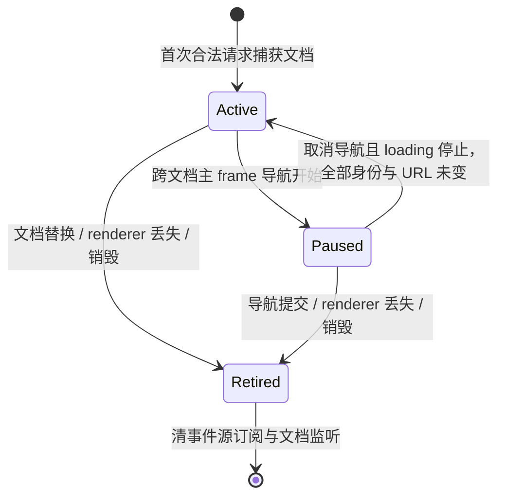

Paused 期间暂停方法调用、新订阅与事件投递，保留旧订阅；已有订阅可取消。取消导航只有在原 frame/token/process/routing/URL 均匹配且主 frame 已停止 loading 后才恢复。恢复不会补发暂停期间丢弃的事件，需要一致快照的业务应设计重读或版本同步。

导航实际提交、崩溃和销毁才退休旧文档；投递固定使用原 frame 的 `send`，避免旧事件进入替换文档。preload 在 `pagehide / unload` 停止本地分发，不再向已退休文档补发 unsubscribe，Main 负责回收资源。框架不会中止已经进入业务 handler 的工作；异步完成后的资源处理仍由领域服务负责。

<a id="lifecycle"></a>
## 6. 应用启动、关闭与失败回收

源码：[main.ts](../frontend/src/main/main.ts)、[bootstrap.ts](../frontend/src/main/bootstrap.ts)、[registerIpc.ts](../frontend/src/main/registerIpc.ts)。

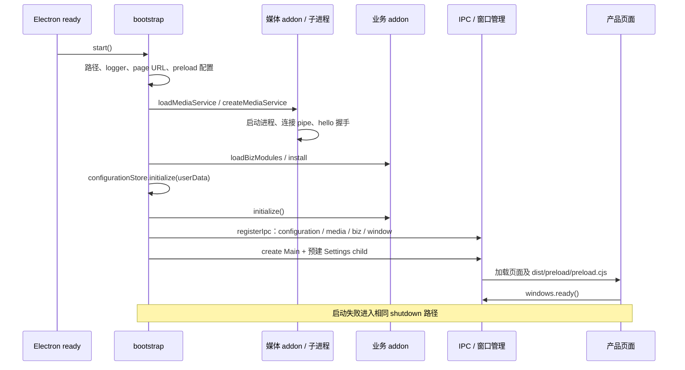

媒体 `createMediaService()` 在返回对象前就同步完成启动与握手。当前 `initialize()` 主要检查 ready 状态，不能把它写成延迟启动或失败后自动重连。业务宿主在窗口创建前初始化。

全局关闭顺序：

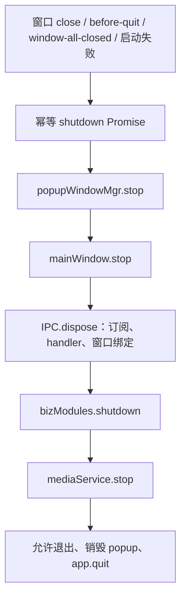

每项清理失败均记录日志并继续后续清理。媒体容器先停预览、再释放原生窗口、最后关闭 addon。addon 再处理断管道、等待/兜底终止子进程、线程与 TSFN 释放。不能把 JS 清理调用返回直接当作实际 OS 进程退出成功的证明。

新增有资源的业务应明确初始化失败如何回滚、关闭是否幂等、事件源何时停止、异步结果是否可能在关闭后返回。业务宿主 `Closed` 为终态；如需重启应创建新宿主，当前没有通用热重启机制。

<a id="windows"></a>
## 7. Renderer、窗口与界面状态

### 7.1 页面组织

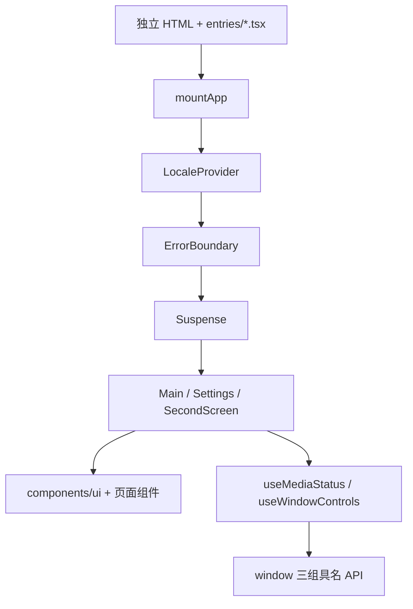

当前是三个独立页面入口，没有 SPA router：

| 页面 | 内容与依赖 | 当前实现范围 |
| --- | --- | --- |
| Main | TitleBar、媒体状态、窗口控制、Workspace、NativePreview、BrowserView、打开弹窗 | 工作台；部分菜单仍为 Notice 占位 |
| Settings | general / stream / video / audio 分组、自身关闭 | 只有 general 内语言设置真实生效 |
| SecondScreen | query `streamId`（默认 0）、StreamPreview、自身关闭、双击最大化 | 预览控制与消费组件 |

hooks 采用先订阅、再读取初始快照的方式，卸载取消。LocaleProvider 通过 revision 过滤旧快照。未来新增具有初始状态与事件的领域，应采用快照版本或等价一致性机制。

### 7.2 窗口管理

- `mainWindow.ts`：主窗口与系统事件，连接媒体原生窗口宿主；退出转入全局 shutdown。
- `childWindow.ts`：预创建 Settings 窗口。正常关闭 child 会隐藏以便复用，退出时才销毁。
- `popupWindow.ts`：登记窗口身份、页面地址、ready、显示请求、复用与业务 ID；统一发送最大化状态。
- `windows.ready`：页面在 layout effect 通知 Main 页面已就绪；popup / child 通过 `showRequested + rendererReady` 控制显示，Main 窗口当前在 Electron `ready-to-show` 时直接 show。
- `showWindow` 当前只允许业务页 `Settings / SecondScreen`；业务 id 不能为保留值 `main / child`；query 只接受 `streamId`。

产品 BrowserWindow 使用 `nodeIntegration: false`、`contextIsolation: true`、`sandbox: true`。BrowserView 的 `WebContentsView` 同样关闭 Node 并启用隔离，但不加载产品 preload。页面登记与顶帧检查共同约束产品 IPC。

### 7.3 三种预览/嵌入组件

| 组件 | 资源所有者与作用 | 布局 / 清理 |
| --- | --- | --- |
| `NativePreview` | Main 页面 DOM 占位 → Main `NativeWindowService` → 媒体进程原生 overlay 窗口 | ResizeObserver、滚动、窗口 resize、DPR 变化；DIP × DPR 转物理坐标；页面退休交 Main 回收 |
| `BrowserView` | Main 创建并持有隔离 `WebContentsView`，Renderer 只提供位置和 URL | DOM 测量、定时更新；loaded/navigated/error 走通用事件；release、pagehide 与关闭清理 |
| `StreamPreview` | Renderer WebGL 消费 VideoFrame；Main 管理唯一消费者与 outstanding token | RAF 留最新帧；丢帧、隐藏、context lost、卸载关闭帧并归还 token |

BrowserView URL 限于 http、https 或 `data:text/html`。是否可嵌入某个业务站点、远端页面的登录与信任策略仍需业务单独定义。

## 8. 配置与跨窗口同步

源码：[configuration 目录](../frontend/src/main/infrastructure/configuration/)。

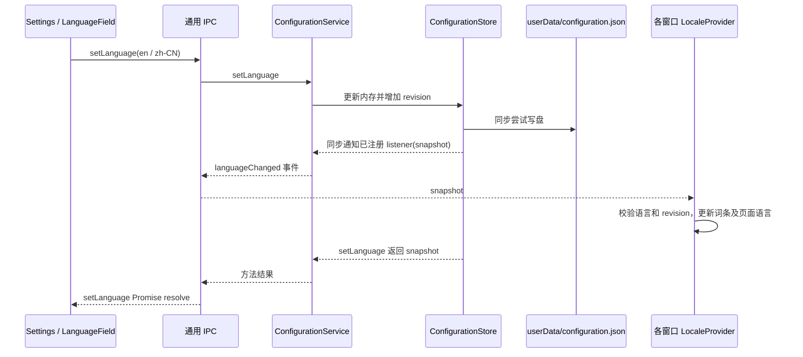

当前配置仅 `{ language, revision }`，默认 `en / 0`。初始化时缺文件或损坏会沿用默认值；`setLanguage` 即使传入相同语言也会递增 revision。

**持久化语义：** 写盘失败目前被吞掉，设置仍在会话内生效、广播并返回成功。这里没有强持久化保证、原子文件替换或事务；界面 save error 也不能覆盖所有磁盘失败。若后续业务存储需要可靠提交，必须先定义成功语义及失败反馈，不能直接沿用此行为。

<a id="business"></a>
## 9. node-bizmodules 业务模块框架

源码：[原生 runtime](../core/node-bizmodules/src/runtime/)、[TestModule](../core/node-bizmodules/src/modules/test/)、[Main 适配层](../frontend/src/main/bizModules/)。

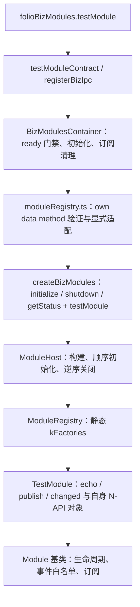

### 9.1 各层职责

| 层 | 负责 | 不应扩张到的职责 |
| --- | --- | --- |
| `ModuleRegistry` | module ID、root property、factory 的静态装配与重复检查 | 业务方法分发总表 |
| `ModuleHost` | 创建全部模块、顺序 initialize、逆序 shutdown、状态与订阅数 | 账号、房间等具体业务方法 |
| `Module` | Created → Ready → Closed、事件白名单、订阅释放、生命周期 hook | 任意字符串业务调用入口 |
| 具体 Module | 自己的具名方法、事件及 N-API 绑定 | 修改媒体 ServiceHost |
| Main adapter / Container | addon 形状校验、具名门面、ready 门禁、订阅追踪 | 原生模块的业务算法 |
| 模块 IPC | Caller、具名方法与事件源连接 | 把 host 生命周期授权给 Renderer |

### 9.2 线程与事件语义

**当前所有业务模块访问均在 originating JavaScript thread，即 Main JS 线程。** `initialize / echo / publish / shutdown` 同步完成原生操作后返回已 settle 的 Promise。Promise 返回类型不代表后台线程；当前没有 worker、async work 或业务 TSFN。

`TestModule.publish` 同步发出 `changed`；原生监听回调抛错会使该次 publish Promise reject。原生 emit 快照订阅 ID，再逐个检查当前记录，允许回调中取消、增加监听或关闭宿主。它与 preload 的“各 Renderer 回调异常隔离”是不同层的语义。

后续迁入阻塞网络调用、重计算或旧业务事件循环前，必须确认线程归属、线程间投递、取消和 shutdown/join 方案；不要直接把耗时逻辑塞进 TestModule 同步骨架。

### 9.3 订阅与 GC 所有权

- 原生 callback 使用弱 `napi_ref`；JS disposer 的 `_callback` 持有 callback，`_owner` 持有根对象，让引用关系对 JS GC 可见。
- 业务函数也持有 owner；原生 MethodContext / SubscriptionContext 通过 `shared_ptr` 保持宿主和模块存活。
- 监听期间必须持有订阅对象；dispose 幂等，GC finalizer 也会释放订阅。Main 容器统一追踪跨 IPC 的 disposer。
- initialize 失败会关闭宿主；shutdown 逆序关闭全部模块，即使单模块失败也继续，Closed 不可重用。
- 当前 fixture 字符串限 32768 UTF-8 bytes；它是验证接口约束，不是所有未来业务 DTO 的默认设计。

<a id="media"></a>
## 10. media-service 与原生控制协议

### 10.1 职责分层

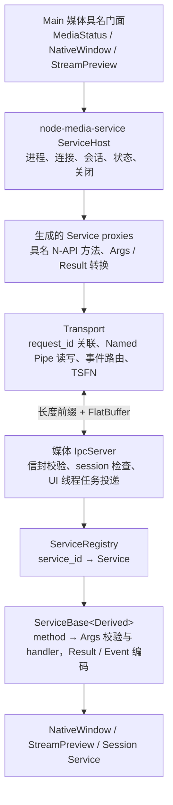

`MediaServiceApplication` 只调用 `services::registerAll`、连接 registry / IPC / EventLoop 并驱动生命周期。新服务在服务端工厂表登记，application 不随每个业务增加成员或路由分支。

当前服务：

| 服务端类 / service_id | addon root 属性 | 职责 |
| --- | --- | --- |
| `NativeWindowService` | `nativeWindowService` | 原生窗口 create、setRect、setVisible、release、releaseAll、refresh |
| `StreamPreviewService` | `streamPreviewService` | 预览对象创建/释放、帧事件接口、归还帧 token |
| `SessionService` | 由宿主内部调用 | hello、会话令牌、受控 shutdown |

### 10.2 线程与调用时序

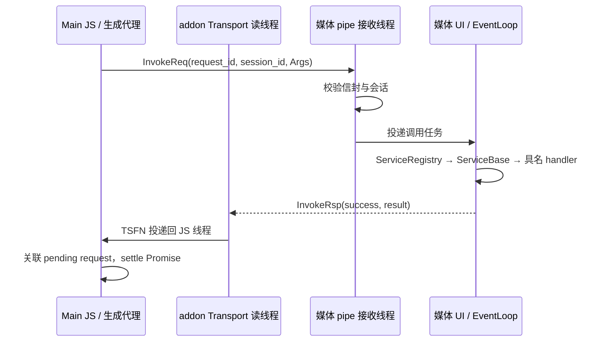

图示为普通媒体方法。addon 还有进程监控线程和关闭用 async work，与本进程业务 addon 的纯同步模型不同。连接期间 `hello` 使用同步等待专用回执路径，避免阻塞 JS 等待 TSFN 造成死锁。`SessionService` 的 hello / shutdown 在媒体 IPC 接收线程执行；其他 Service 方法投递到 EventLoop/UI 线程。StreamPreview 还拥有专用 GPU worker，不能把全部图形工作描述为 UI 线程执行。

### 10.3 协议信封

传输帧为 **4 字节小端消息长度 + FlatBuffer 字节**，当前消息上限 8 MiB。Windows Named Pipe 是单实例、单客户端、双向 byte stream，采用 OVERLAPPED I/O，发送锁串行写完整帧。权威信封定义为 [service.fbs](../core/schemas/service.fbs)。

| 表 | 字段与含义 |
| --- | --- |
| `InvokeReq` | `type`、`service_id`（C++ 类名）、`method`、`request_id: ulong`、`session_id: ulong`、`args: [ubyte]` |
| `InvokeRsp` | `type`、`service_id`、`request_id`、`session_id`、`success`、`message`、`result: [ubyte]` |
| `ServiceEvent` | `type`、`service_id`、`event`、`payload: [ubyte]` |
| `HelloArgs / HelloResult` | `version: uint` / `session_id: ulong, compatible: bool` |
| `ShutdownArgs / ShutdownResult` | 空表，表达受控关闭请求与回执 |

`MessageType` 当前为 `None=0 / InvokeReq=1 / InvokeRsp=2 / Event=3`。hello 请求 session 为 0、协议版本为 1；当前服务端将 session 从 0 设为固定值 1，之后每次调用回显并检查。它尚不是随机或跨重连唯一令牌。request ID 用于关联请求与回执，session 表示握手状态/归属；它们不能替代产品用户身份或业务授权。

`ServiceEvent` 当前信封没有 session 字段。新增普通原生事件使用此机制；纹理数据面单独处理。ulong / uint64 值跨 JS 时应保持 bigint 或接口既定字符串表示，不能无条件转 number 或经过 JSON。

### 10.4 每个 Service 的 schema

方法由同名 `XxxArgs / XxxResult` 配对，方法名为 Args 表去掉后缀并首字母小写。当前字段示例：

```fbs
// native_window_service.fbs，省略 namespace 与各表 root_type 声明。
table CreateArgs { id: uint; host: ulong; host_visible: bool; }
table CreateResult {}
table SetRectArgs { id: uint; x: int; y: int; width: int; height: int; }
table SetRectResult {}
table SetVisibleArgs { id: uint; visible: bool; }
table SetVisibleResult {}
table ReleaseArgs { id: uint; }
table ReleaseResult {}
table ReleaseAllArgs {}
table ReleaseAllResult {}
table RefreshArgs { id: uint; host: ulong; host_visible: bool; }
table RefreshResult {}

// stream_preview_service.fbs，省略 namespace 与各表 root_type 声明。
table CreateStreamPreviewArgs { id: uint; }
table CreateStreamPreviewResult {}
table ReleaseStreamPreviewArgs { id: uint; }
table ReleaseStreamPreviewResult {}
table ReleaseVideoFrameArgs { id: uint; token: ulong; }
table ReleaseVideoFrameResult {}
table FrameEvent {
  id: uint;
  token: ulong;
  handle: ulong;
  width: uint;
  height: uint;
  timestamp_us: long;
}
```

当前文件通过多个 `root_type` 标记需要生成 Verify/Get 的表，由项目生成器逐 root 调用 flatc 并合并；不要直接把多 root 文件当成一次标准 flatc 输入。修改协议需检查双方兼容性，已有枚举新增值只追加，不能改变旧值。

### 10.5 原生实现范围与调用失败语义

| 项目 | 当前行为 |
| --- | --- |
| NativeWindow | Windows `WS_POPUP` owner overlay，owner 指向 Electron 窗口；并非 `WS_CHILD`。目前黑底占位，未接入生产画面，也没有查询/句柄返回或状态事件 API |
| StreamPreview 输入与 GPU | C++ 输入视图支持 SDR I420 / NV12 / BGRA，经 framebuffer 与专用 worker 的 D3D11 转共享 BGRA NT HANDLE；addon 按子进程 PID 使用 DuplicateHandle |
| 资源容量 | StreamPreviewService 最多 32 presenters / 96 published outstanding frames；单 worker 的 in-flight 槽位为 3。它们是代码边界，不是已经测得的产品并发性能指标 |
| 真实帧来源 | schema 没有采集/帧输入接口；默认应用没有生产帧源。Config 中部分 `--sdk-*` 参数仅被解析，不能据此推断 SDK 已接入 |
| 未知原生 service / method | registry 返回 false，但当前调用执行路径未补发失败回执，普通请求可能一直 pending |
| 断连与未完成调用 | 写帧失败会 reject；断连/停止清除普通 pending 表时不主动 reject 全部 Promise，当前也没有普通请求 timeout / cancel |
| 回执字段 | `InvokeRsp.service_id` 当前写空串，实际按 request_id 关联；不要依赖该字段做结果路由 |
| 关闭协议 | schema 有 Session shutdown；当前 addon stop 实际先断 pipe，等待子进程，超时终止，并非必定发送 shutdown 方法 |

后续媒体业务应对超时、断连、迟到结果和失败回执补充明确语义；不能把 Electron IPC 的结构化失败回复理解为已经解决原生 transport 的 pending 回收。

<a id="generation"></a>
## 11. 原生 schema 生成与构建关系

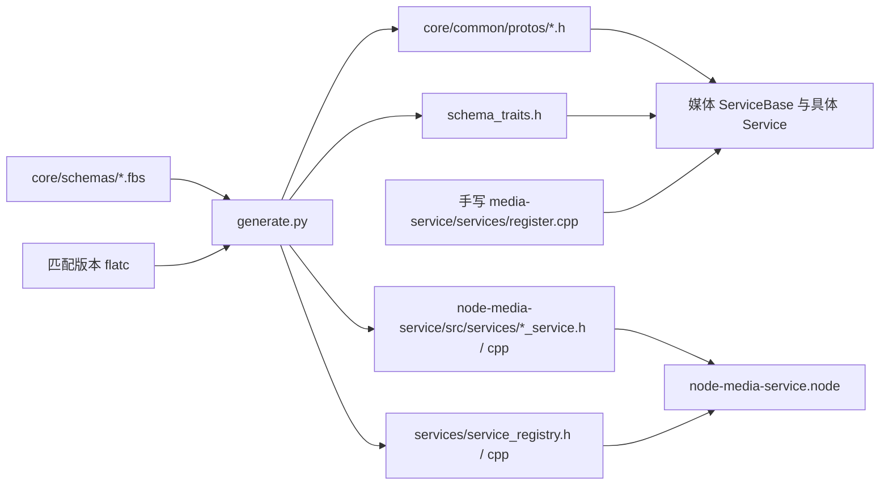

生成物已入库；代理工厂表由 schema 生成，**服务端工厂表仍需手工登记**。`ServiceProxy` 基类、Host、Transport 和 TS facade 不由这条链自动生成。

在项目根执行：

```powershell
python core/schemas/generate.py
python core/schemas/generate.py --check
```

生成器当前硬编码读取 `build/schema/_deps/folio_flatc-src/flatc.exe`，该路径必须先有匹配版本工具；它没有通用 PATH 查找或 Python 命令行覆盖参数。`FlatBuffers.cmake` 的覆盖变量属于 CMake 层，不能直接当作 Python 生成器的参数。`--check` 当前实现是先生成、再比较已有文件字节，**不是只读检查**；执行后必须检查 diff，不要用它证明没有写文件。

当前 CMake 接线限制：

- `core/CMakeLists.txt` 仅在 `FOLIO_SCHEMA_ONLY=ON` 分支 include `Schemas.cmake`；普通构建使用已入库生成物，不能假定 `scripts/build.py` 会自动重新生成。
- `Schemas.cmake` 定义 `generate-schemas` 目标，依赖 `core/schemas/` 下的三个 schema；执行前仍须在上述固定路径准备匹配版本的 `flatc.exe`。
- 新增媒体 schema 后，除运行 Python 生成器，还须检查媒体与 addon CMake 源文件/依赖列表；现有文件列表并非完整自动发现。

这些是当前源码限制，本轮文档整理不改变生成器或构建代码。后续若修复，应同时更新本节和相关验收记录。

<a id="preview"></a>
## 12. 共享纹理数据面与资源所有权

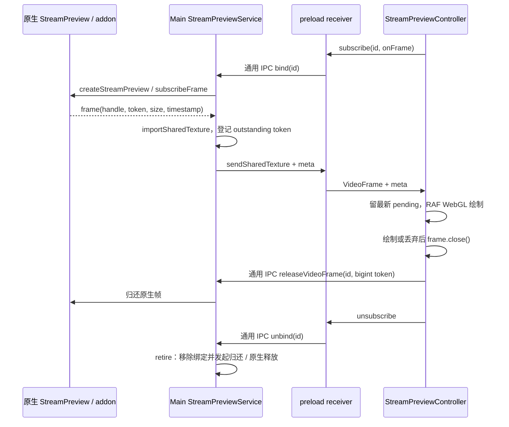

此图描述已有控制和消费链。当前原生预览还没有接入真实生产帧源，不能由该图推断已实现完整的采集/编码/直播管线或已验收 GPU 画面。

| 资源 | 谁持有 | 何时释放 |
| --- | --- | --- |
| Main 预览 binding | `StreamPreviewService`，每 id 一个消费者，绑定文档身份 | unbind、导航提交后身份变化、renderer 丢失、销毁、stop 时 retire |
| 导入的共享纹理 | Main / preload 的 sharedTexture 接口 | Main 在 send 的 finally 中 release 自己的引用；preload 无 callback 时 release 接收引用 |
| `VideoFrame` | Renderer 帧 callback / Controller | 绘制、被新帧替换、隐藏、context lost、dispose；均需 close |
| 原生帧 token | 原生预览对象；Main 跟踪传输引用对应的 outstanding token | Renderer 显式 release 或 Main 失败 / retire 兜底归还；原生 releaseFrame 按幂等处理 |
| NativePreview 原生窗口 | Main `NativeWindowService` 的 key → numeric id 映射 | 正常卸载或 Main 统一回收 |
| BrowserView | `BrowserViewMgr`，按 owner + id 管理 | release、owner 退休、全局 stop |

关键约束：

1. token 为 uint64，JS 使用 `bigint`；流 id 为 uint32。不要把 token 转 number、拼入 JSON 或当作 Renderer 可任意归还的句柄。
2. preload 每流一个本地 callback；bind 失败撤回登记，取消幂等。Main 另行核实 frameToken / processId / routingId 与消费者。
3. Controller 只留最新 pending 帧，被替换帧立即 close 并归还 token；隐藏和 context lost 也处理 pending。
4. WebGL 使用 VideoFrame 绘制，当前没有 Canvas2D/CPU 回读路径；这不构成完整端到端零拷贝性能保证。
5. 普通 IPC 不克隆 VideoFrame 或共享 handle。未匹配 callback 的帧与 callback 抛错均有局部释放分支，真实 GPU 端到端所有权仍需真实帧源验证。

当前实现的两个重要边界：

- `allReferencesReleased → resolved()` 只删除 outstanding 记录，与 Renderer 的原生 token 归还不是同一个完成信号。`releaseVideoFrame` 检查 known id，binding 存在时核对消费者和文档；binding 回收后允许兜底归还，未验证 token 是否在 outstanding 内，因此不能宣称已实现完整 token 授权或防重校验。
- `drainDocument()` 已有辅助实现，但当前源码没有调用者。unbind 和导航身份变化直接 retire，原生 release 为 fire-and-forget；unbind Promise 完成不代表所有原生资源已释放。后续真实 GPU 接入应补充 drain 接线、迟到帧与 token 所有权验证，再承诺等待所有引用释放后导航。

<a id="add-ts"></a>
## 13. 新增纯 TypeScript 能力

以下为**接入约定与示例**。业务名 `example` 未在产品中实现；正式业务使用自己的领域名和 DTO。

### 13.1 推荐落点

一般业务可新增 `frontend/src/main/<businessName>/`；基础设施能力沿 `infrastructure/<name>/`。先保持单业务目录内聚，只有实现规模需要时再拆子目录，不要求每个能力都创建空的 store、adapter 或 native 层。

```text
main/example/                 # 示例，尚不存在
  contract.ts                # 公开方法、事件、DTO、validators
  ipc.ts                     # registerExampleIpc
  service.ts                 # 业务规则
  store.ts                   # 仅确有状态/存储需求时创建
```

### 13.2 最小连接示例

```ts
// 示例 contract.ts：依赖路径按实际目录调整。
import { contract, event, method, singleString, stringValue } from '../../ipc/contract.js';

export const exampleContract = contract({
  id: 'example',
  methods: { echo: method(singleString, stringValue) },
  events: { changed: event(stringValue) },
});

// 示例 ipc.ts：service.onChanged 必须返回幂等取消函数。
export function registerExampleIpc(server: IpcServer, service: ExampleService): void {
  server.register(exampleContract, {
    echo: (_caller, value) => service.echo(value),
  }, {
    changed: (_caller, emit) => service.onChanged(emit),
  });
}
```

该片段展示声明与绑定形式，省略 IPC 文件自身的 type / contract imports 和业务实现。真实参数应加入长度、枚举、数值范围和对象字段限制，避免直接把宽松 `stringValue` 当作所有业务输入的验证方案。

完整接入步骤：

1. 定义业务成功语义、DTO、事件与资源归属；先决定属于纯 TS、本进程 C++ 还是媒体进程。
2. 在所属目录写浏览器安全 `contract.ts`。描述符只声明允许公开的能力，方法默认 page，Main 页面专属能力显式设 `'main'`。
3. `service.ts` 实现业务规则；`ipc.ts` 绑定明确的方法与事件源，需要身份时传入可信 Caller。
4. `bootstrap.ts` 创建有生命周期的服务并安排清理；`registerIpc.ts` 静态注册。简单无状态对象不必硬加全局容器。
5. preload `client.bind(exampleContract)` 后显式放入合适的公共 facade。通用业务一般归 `folioBizModules`，配置/窗口等应用基础能力归 `folioMain`；不要塞入媒体 facade。
6. 事件若需握手完成保证，公开 `{ dispose, ready }` 对象；遵守现有错误观察与页面关闭约定。
7. Renderer 从全局 API 调用，在 hook/effect 中取消监听；`app/types.d.ts` 随实际 preload facade 推导。
8. 构建并验证成功、非法输入、权限拒绝、订阅取消、导航/关闭清理。通常无需修改 `ipc/` 核心。

<a id="add-biz"></a>
## 14. 新增或迁入 C++ 业务模块

沿当前框架需要以下静态接线。这里没有业务模块代码生成器，不能仅添加一行工厂就假定 Renderer 自动获得所有方法。

| 步骤 | 修改位置 | 要求 |
| --- | --- | --- |
| 1. 实现模块 | `core/node-bizmodules/src/modules/<name>/` | `Module` 子类、完整 lifecycle、具名 N-API 方法与事件 |
| 2. 登记原生模块 | `src/runtime/module_registry.cpp` | 追加 ModuleFactory；类名 ID + camelCase root property，检查唯一性 |
| 3. 纳入构建 | `core/node-bizmodules/CMakeLists.txt` | 添加实际源文件；C++11，新 C++ 文件 BOM + CRLF |
| 4. 同步原生 API 类型 | `core/node-bizmodules/index.d.ts`、`main/bizModules/addon.ts` | 当前存在本地镜像，需同步维护，不是自动生成 |
| 5. 显式适配 | `main/bizModules/moduleRegistry.ts` | own data function 校验、具名方法与 disposer 适配 |
| 6. 业务门面 | `main/bizModules/bizModules.ts` | ready 门禁、具名属性、订阅追踪与统一清理 |
| 7. Renderer 边界 | 所属 `contract.ts / ipc.ts`、`registerIpc.ts`、preload | validators、页面权限、具名 facade，host lifecycle 留在 Main |
| 8. 页面接入 | 对应 page、hook / service | 订阅、快照、加载与错误状态，取消和并发语义 |

生产业务增长后，可按领域在 Main 拆出独立目录，由 `bizModules` 保持原生宿主装配职责，避免一个共享 `contract.ts / ipc.ts` 长成全部业务总表。这是**后续组织建议**，当前目录仍只有 TestModule 的完整骨架。

迁入旧 C++ 前应列出它依赖的全局单例、线程、网络回调、磁盘路径、UI 框架和关闭顺序。旧 Qt/UI 对象不能直接穿透 N-API；用 DTO 和事件描述边界，并在其合法线程访问。若需要后台执行，先补齐线程模型与资源回收，再迁入耗时业务。

<a id="add-media"></a>
## 15. 新增媒体 Service

1. `core/schemas/<name>_service.fbs` 定义配对 Args / Result 与可选 XxxEvent，按项目约定声明 root；通用 `InvokeReq / InvokeRsp / ServiceEvent` 不随业务增加表。
2. 运行 [生成命令](#generation)，检查 protos、traits、addon 同名 Service 代理、代理工厂表 diff。不要手改生成文件。
3. `core/media-service/src/services/<name>/` 实现 `ServiceBase<Derived>` 子类；构造时 registerMethod，使用 typed handler；普通事件通过现有 emit 机制。
4. `core/media-service/src/services/register.cpp` 的工厂表登记服务；Application 保持调用 registerAll。同步媒体与 addon CMake 列表。
5. 同步 `core/node-media-service/index.d.ts` 与 Main `mediaService/addon.ts` 类型镜像；需要页面适配时添加 TS 具名门面。
6. 更新媒体目录 `contract.ts / ipc.ts`，在 preload 公开明确能力。非媒体业务应选其他路径。
7. 校验握手、请求/响应、非法参数、断连、子进程异常退出、stop 与 OS 退出；涉及帧资源时还要验证真实 GPU 数据面和 token 回收。

命名链应可对照：`xxx_service.fbs → XxxService → service_id "XxxService" → addon.xxxService → TS 具名门面 / capability`。Electron capability 可为已有 facade 兼容而保持当前名字，变更公开名称前检查全部调用点。

<a id="migration"></a>
## 16. 后续业务重构与迭代路线

以下为**迁移建议**，不是当前已具备的自动迁移或灰度设施。

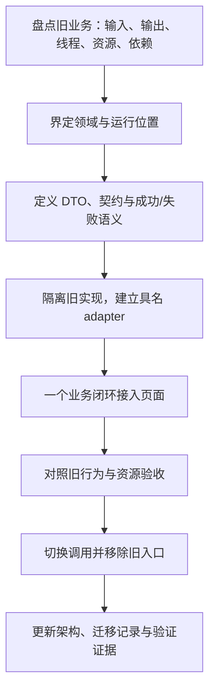

### 16.1 一次迁移的最小业务闭环

围绕一个用户可见目标交付完整链路：页面状态 → 具名 API → Main 业务门面 → 旧实现适配 / 新实现 → 结果与事件 → 关闭回收。不要以“目录搬完”作为业务迁移完成标准。

| 必须明确的问题 | 在方案或实现中留下的内容 |
| --- | --- |
| 谁拥有状态 | Main / 原生模块 / 媒体进程中的唯一事实源；Renderer 的只读快照与本地 UI 状态 |
| 谁可以调用 | 页面权限、账号权限、资源 owner，避免相信请求内的 sender/user 标识 |
| 请求何时成功 | 内存更新、持久化、网络确认或服务端完成；失败如何反馈 |
| 并发与重复调用 | 顺序、幂等、旧结果覆盖、取消与版本号；框架没有默认保证 |
| 事件如何同步 | 初始快照、订阅握手、revision/sequence、断连后重读；事件暂停不自动补发 |
| 谁释放资源 | 正常卸载、导航、崩溃、启动失败、应用退出下的明确 owner |
| 如何撤回迁移 | 清晰的调用切换点、必要时显式开关、旧数据兼容与回退步骤 |

迁移存在写入、扣费或发布等副作用时，避免把“新旧并行对照”变成双重执行。可先对照只读结果或回放输入；切换与回退方案应在该业务中实现并验证。

### 16.2 建议的变更范围

- 业务新增以所属模块为主，触及公共装配、preload 和类型边界是明确接线。
- 不为每个业务重复建立 Electron transport、Named Pipe、通用 dispatcher。
- 仅在出现明确共性并有两个以上实际调用场景时提取共享逻辑；目录和抽象按真实职责增长。
- 旧接口删除前搜索所有 Renderer、Main、addon 类型与测试缓存调用点，确认无遗留消费者。
- 变更资源所有权、权限或线程模型时，先更新对应图，再实现与验证。

<a id="build"></a>
## 17. 构建、开发、发布与文件边界

源码：[scripts/build.py](../scripts/build.py)、[Vite preload 配置](../frontend/vite.preload.config.mjs)、[开发入口](../frontend/scripts/dev.mjs)。

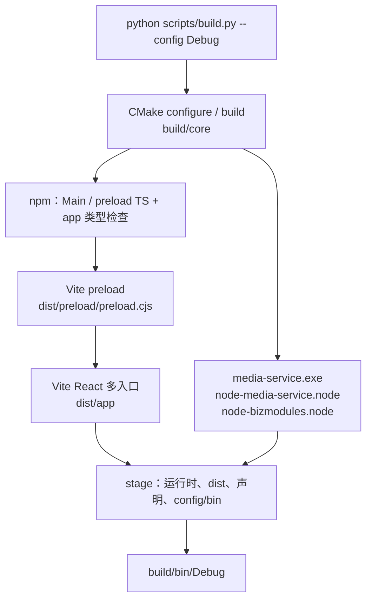

### 17.1 最短命令

在本子工程根目录执行：

```powershell
python scripts/build.py --config Debug
.\build\bin\Debug\folio.exe .\build\bin\Debug\resources\app
```

React 开发使用 Vite dev server，仍需先准备匹配的原生产物；开发启动脚本不会代替 CMake 构建。从项目根开始，给 addon 所在媒体目录传绝对路径，避免 `createRequire` 的相对路径解析与工作目录不同：

```powershell
$mediaExe = (Resolve-Path .\build\bin\Debug\media-service.exe).Path
$configDir = (Resolve-Path .\config).Path
Push-Location .\frontend
try {
  npm run dev -- "--media-service-exe=$mediaExe" "--config-dir=$configDir"
} finally {
  Pop-Location
}
```

开发脚本设置 `VITE_DEV_SERVER_URL`；bootstrap 使用该 URL 下的三个 HTML，否则加载 dist/app 的 file URL。开发启动读取相邻媒体 exe 目录中的两个 addon。preload 两种模式都加载构建好的 `dist/preload/preload.cjs`，其 bundle 唯一 external 是 Electron。

### 17.2 当前可分发布局

```text
build/bin/Debug/
  folio.exe                           # 更名和品牌化的 Electron 运行时
  media-service.exe
  node-media-service.node
  node-bizmodules.node
  node-media-service.d.ts
  node-bizmodules.d.ts
  settings.ini                        # config/bin 内容铺平
  ...Chromium runtime files...
  resources/app/
    package.json
    dist/
      main/
      ipc/
      common/                         # 现有兼容导出
      preload/preload.cjs
      app/                            # HTML + 打包 JS/CSS
    node_modules/@electron/remote/     # 当前仍随 stage 保留
  logs/                               # 默认运行后生成
```

stage 不复制源目录、测试缓存或整个 config/。图标由构建期资源步骤处理，config/bin 的文件直接放在产物根。当前是可分发目录 stage，不代表已经提供安装器、签名、自动更新与发版流水线。

### 17.3 配置、日志与本地缓存

| 内容 | 当前位置 / 覆盖方式 | 是否入库 / 随 stage |
| --- | --- | --- |
| 语言配置 | `app.getPath('userData')/configuration.json` | 用户运行数据；不随 stage |
| Main 日志 | 默认 exe 同级 `logs/main.log`，`--main-log=` 覆盖 | 运行数据 |
| 媒体日志 | 默认 Main 日志同目录 `media-service.log`，`--media-service-log=` 覆盖 | 运行数据 |
| 媒体 exe | 默认 UI exe 同级；`--media-service-exe=` 覆盖 | stage 原生产物 |
| pipe 名 | 默认按 UI pid 区分；`--pipe-name=` 覆盖 | 运行期连接标识 |
| 本地验证脚本 | `build/cache/verification/` | Git 忽略；不打包；可被清理 |
| 验证证据与报告 | `build/logs/` 下每次独立 run | Git 忽略；不打包 |

`scripts/` 保留正式构建工具；临时测试脚本不放这里，也不加入 npm 发布或 stage 复制列表。现有缓存脚本不是干净 checkout 必然具备的正式测试套件；缓存被清理后，应按明确测试任务恢复或重新生成，不能让产品构建依赖它。

<a id="verification"></a>
## 18. 验收矩阵、现有证据与已知限制

### 18.1 后续变更的最低验收范围

按变更实际边界选择，不要求纯文档重复运行产品 E2E：

| 变更类型 | 应覆盖 |
| --- | --- |
| 普通 TS 业务 | TS 构建；有效/非法输入；方法与事件；成功/失败；订阅卸载 |
| 公共 IPC / preload | 权限、顶帧、未知键/accessor、参数/结果/payload、同步初始事件、订阅复用、提早取消、握手失败 |
| 页面或窗口 | 真实 staged 页面、ready、复用、状态同步、权限拒绝；目标 UI 截图 |
| 文档生命周期 | 取消导航恢复、实际导航退休、iframe 拒绝、renderer loss、销毁与关闭零遗留 |
| C++ 业务模块 | 原生方法/字符串/GC、初始化失败、回调异常、重入、逆序关闭、零订阅与 Main 自然退出 |
| 媒体控制 | 生成物一致、hello/session、方法回执、断连、子进程关闭；独立 OS 句柄观察退出 |
| 纹理或预览 | 上述控制 + 真实帧源、显示截图、连续消费/丢帧、bigint token、切流、导航回收；接入 drain 后验证等待语义，以及 GPU/context lost 与退出 |

本地缓存验证入口（缓存存在时）：

```powershell
python build/cache/verification/verify_bizmodules.py --config Debug
```

该入口串行运行原生、通用 IPC / preload VM、真实 staged Electron 与缺 addon 启动失败检查。成功 run 要有真实 Renderer 结果、closed / 零订阅、自然退出和截图；`latest-run.txt` 只在成功时更新，不等于“最近一次执行成功”。

### 18.2 本次架构基线的验证边界

| 项目 | 已有证据 / 限制 |
| --- | --- |
| 完整框架成功轮次 | `build/logs/bizmodules-registry/20261015-190151-785e1f79/` |
| 真实取消导航修复验证 | `build/logs/ipc-framework/20261015-190200-abort-fixed-1aad43ec/` |
| IPC 汇总报告 | `build/logs/ipc-framework/acceptance.html` |
| 测试脚本迁缓存 | `build/logs/test-script-relocation/20261015-193943/`；脚本语法、Git ignore、产物无测试副本及机制验证已有证据 |
| 搬迁后完整 UI 复验 | 两次在 BrowserView `capturePage()` 报 `UnknownVizError`，未完成全套截图验收；根因尚未确认，不能把此前成功 run 说成搬迁后的成功 run |
| GPU 数据面 | 无真实生产帧源；控制链、VM 资源分支与 bigint 传递不能证明端到端画面通过 |
| 媒体状态双回调 | 部分验证通过通用事件出口注入当前快照，不能宣称原生主动状态变更已覆盖 |
| 媒体实际退出 | 以独立 Win32 进程句柄记录的 OS exit code 为准；nativeClose 部分字段是既有常量遥测 |

证据目录是本地缓存；清理后不会随源码恢复。后续迭代应生成新的唯一 run，记录当轮代码、命令、结果与真实截图，不覆盖历史成功结论或省略失败。

### 18.3 待需求或后续重构解决的事项

| 当前边界 | 后续处理触发条件 |
| --- | --- |
| TestModule 是唯一 C++ 业务 fixture；生产页面未消费它 | 首个生产业务迁移时建立真实 DTO、状态和错误模型 |
| biz 原生方法在 Main 线程 | 出现阻塞/重计算/多线程旧模块时，先设计执行与 shutdown 模型 |
| 配置写盘异常被吞掉 | 配置需要可靠持久化时，定义写失败与提交语义 |
| addon `index.d.ts` 与 Main 本地类型镜像手工同步 | 接口增长后可评估类型共享/生成，当前不能假定自动同步 |
| schema 生成目标接线存在限制 | 修改 FBS 或接入自动生成门禁时修复并验证 CMake 接线 |
| 原生未知方法无失败回执、断连 pending 未全部 reject、session 固定为 1 | 扩展媒体业务或可靠性治理时完善协议与连接生命周期 |
| IPC 错误为字符串，无通用超时/取消/重试/幂等 | 具体业务要求跨边界控制时，有针对性扩展 |
| 没有动态插件扫描、DI 容器、业务 worker、统一观测平台 | 由真实业务复杂度驱动，不提前建立空框架 |
| GPU 完整验收未完成、BrowserView 截图错误未定位 | 有真实帧源或调整窗口/GPU链路时补充专门验证 |
| 预览 drain 尚无调用者、token 检查范围有限 | 真实 GPU 接入前明确导航与异步释放语义，补齐对应验证 |

## 19. 源码导航与文档维护

| 架构事实 | 权威源码 |
| --- | --- |
| 应用装配与失败回收 | [bootstrap.ts](../frontend/src/main/bootstrap.ts)、[registerIpc.ts](../frontend/src/main/registerIpc.ts) |
| IPC 描述符、授权与文档生命周期 | [contract.ts](../frontend/src/ipc/contract.ts)、[server.ts](../frontend/src/ipc/server.ts)、[client.ts](../frontend/src/ipc/client.ts) |
| 公共 API 与 Renderer 类型 | [preload.ts](../frontend/src/preload/preload.ts)、[types.d.ts](../frontend/src/app/types.d.ts) |
| 能力契约 | [configuration](../frontend/src/main/infrastructure/configuration/contract.ts)、[media](../frontend/src/main/mediaService/contract.ts)、[biz](../frontend/src/main/bizModules/contract.ts)、[window](../frontend/src/main/window/contract.ts) |
| 窗口与网页嵌入 | [popupWindow.ts](../frontend/src/main/window/popupWindow.ts)、[browserView.ts](../frontend/src/main/window/browserView.ts) |
| 帧所有权与绘制 | [Main StreamPreviewService](../frontend/src/main/mediaService/streamPreviewService.ts)、[Renderer Controller](../frontend/src/app/components/StreamPreview/streamPreview.ts) |
| C++ 业务生命周期与工厂 | [module_host.cpp](../core/node-bizmodules/src/runtime/module_host.cpp)、[module_registry.cpp](../core/node-bizmodules/src/runtime/module_registry.cpp)、[module.cpp](../core/node-bizmodules/src/runtime/module.cpp) |
| 媒体宿主与原生传输 | [service_host.cpp](../core/node-media-service/src/runtime/service_host.cpp)、[transport.cpp](../core/node-media-service/src/runtime/transport.cpp) |
| 媒体进程与服务注册 | [application.cpp](../core/media-service/src/application.cpp)、[register.cpp](../core/media-service/src/services/register.cpp)、[ServiceBase](../core/media-service/include/service.h) |
| 协议与生成 | [service.fbs](../core/schemas/service.fbs)、[generate.py](../core/schemas/generate.py)、[Schemas.cmake](../core/cmake/Schemas.cmake) |
| 构建与发布布局 | [build.py](../scripts/build.py)、[core CMake](../core/CMakeLists.txt)、[package.json](../frontend/package.json) |

文档维护要求：

1. 修改进程边界、通信模型、权限、线程、状态归属或资源所有权时，随代码更新对应图、能力表和限制。
2. 新增业务时更新目录/能力索引；已实现业务与未来示例明确区分，不复制第二份公共契约清单。
3. 新的验证结论写明当轮证据；未验证项保留，不用协议图或构建成功替代运行验收。
4. 文件重命名或目录迁移后检查相对链接、图中名称及构建命令。`FRAMEWORK.md` 只保留本页入口，减少重复维护。
5. 项目 AI 代码规则以父仓 [docs/agent.md](../../docs/agent.md) 为准；本文不覆盖编码、C++11、枚举追加、构建与 WIP 保留要求。
